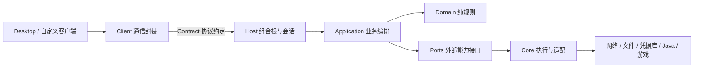

# Plain Craft Launcher Refactoring Core

PCL 原作者：**龙腾猫跃（LTCatt）** · [支持原作者](https://meloong.com/afd/a/LTCat)。这是第三方基于 PCL 独立二次创作的项目，并非 PCL 官方版本。保留并继续使用 [PCL 指南](PCL-LICENCE.txt)。应用显示名仍为 **Plain Craft Launcher Refactoring**。

项目目标是建立 **macOS、Windows、Linux 通用的 Minecraft 启动器核心**，让开发者复用安装、账户、依赖求解、资源管理和游戏进程能力，自由选择 UI 组件库、组织页面并制作自己的客户端。核心不决定控件、导航或视觉风格，客户端不复制业务规则。

## 当前状态

当前源码已推进到 **0.42.1 分包版**（Host 序号 42102，本地 build 424），基于最新修复核心 `81016b4`；完成独立客户端/Host 交付、签名发布与配套更新策略；本地追加[百科/映射数据包](docs/0.42.1-数据分包.md)、[客户端自更新](docs/0.42.1-客户端自更新.md)及[统一更新与清理](docs/0.42.1-统一更新与清理.md)。构建与验证见 [0.42.1 分包交付](docs/0.42.1-分包交付.md)。以下为既有公开发布记录，不表示已自动发布 0.42.1 附件。

此前公开发布版本为 **0.42.0 Preview**：Apple Silicon macOS 14+ 的 Avalonia 参考客户端 + 独立 .NET Host。本版纳入统一模组浏览、Host 签名更新、独立最小客户端和三平台凭据适配等 main 增量；默认官方签名更新源仍未配置。既有 v0.41.0 附件保持不变。复现本版使用 `v0.42.0` 标签，继续开发使用 `main`；现行[架构规范为 v1.5.2](docs/architecture/PCL-Mac架构规范.md)。本版交付与验证见[0.42.0 发布记录](docs/0.42-发布记录.md)。

SwiftUI、Windows/Linux 原生图形客户端尚未实现；Windows/Linux 的 Java/natives、完整游戏运行、真人账户/皮肤及其他平台组合仍需补齐验收。共用代码、构建通过和完整产品可用是不同结论。Git/隐私基线从 v0.36.1 开始，不重新导入旧项目历史。

## 按更新块浏览仓库

开发按职责分组件，更新按能保持兼容的一组组件交付。下表同时列出当前实现和后续方向；完整目录对应及特殊资产见[仓库结构与更新分块](docs/仓库结构与更新分块.md)。

| 更新块 | 包含内容 | 交付方式与当前状态 |
|---|---|---|
| **客户端包** | [Desktop](src/Pcl.Desktop/)、[Client](src/Pcl.Client/)、匹配的 [Contract](src/Pcl.Contract/)、界面资源和 [Native](src/Pcl.Native/) 窗口桥接 | 整体发布客户端；支持 Mac ARM64 签名更新、退出后替换与启动失败回退（需预置更新策略） |
| **Host 核心包** | [Host](src/Pcl.Host/)、[Application](src/Pcl.Application/)、[Domain](src/Pcl.Domain/)、[Ports](src/Pcl.Ports/)、[Core](src/Pcl.Core/)，以及匹配 Contract、必要 Legacy、上游库和运行依赖 | 按系统/CPU 架构整包验证和发布；已有可配置签名更新，默认官方频道未配置 |
| **数据与内容包** | 百科索引、项目映射、兼容表、帮助、语言和主题等适合外置的内容 | 百科/项目映射已支持签名独立更新、兼容检查与回退；其他内容仍按原方式管理 |
| **外部工具与运行环境** | 游戏 Java、EasyTier 等 | 按各自版本、平台与校验信息管理；现有自动 Java/EasyTier 路径限定 Apple Silicon Mac |
| **开发与验证工具** | [tests](tests/)、[scripts](scripts/)、[tools](tools/)、[examples](examples/)、[CI](.github/workflows/core-ci.yml) | 随源码维护，通常不进入用户更新包；生成的运行资产和可独立部署的示例另作区分 |

**当前 Mac 打包脚本仍把客户端和完整 `host/` 一起放进 `.app`。** 上表划分的是兼容与交付边界，尚未形成全部独立下载包。Contract 随两端匹配携带，不让用户单独替换；Host 内部 DLL 也不作为可任意组合的更新包。

原生窗口桥当前可随 Desktop/Host 复制；百科原始索引在 `vendor/PCLCS`；布局和功能矩阵部分嵌入 Desktop；`SharedProtocol` 是链接编译源码。具体归属见[跨分类资产](docs/仓库结构与更新分块.md#跨分类资产)。

## 仓库与文档入口

| 目的 | 入口 |
|---|---|
| 按目录定位组件 | [源码组件索引](src/README.md)、[完整分类与仓库配置](docs/仓库结构与更新分块.md) |
| 按用途找文档、发布和历史证据 | [文档导航](docs/README.md)、[文档状态与弃用索引](docs/文档状态与弃用索引.md) |
| 理解架构、依赖和生命周期 | [架构与设计取舍](docs/架构与设计取舍.md)、[架构规范](docs/architecture/PCL-Mac架构规范.md) |
| 开发新客户端 | [客户端接入指南](docs/客户端接入指南.md)、[独立最小客户端](examples/Pcl.MinimalClient/README.md) |
| 定位功能实现、构建及测试 | [功能实现导览](docs/功能实现导览.md)、[开发与验证](docs/开发与验证.md) |
| 查看缺口与追踪数据 | [剩余清单](docs/剩余清单.md)、[技术债](docs/architecture/技术债.md)、[支持范围](docs/支持范围.md)、[数据说明](docs/data/README.md) |
| 接手项目与分支 | [开发交接 Prompt](docs/开发交接Prompt.txt)、[Git 与交接](docs/Git历史与交接.md) |

## 架构与功能归属

下图表示运行时调用。Desktop 运行时只依赖 Client/Contract；Host 和架构守卫在其项目文件中属于构建依赖。Host 一侧负责权威校验及执行，Domain 不引用 Ports；外部数据先取得再传给纯规则。



自定义非 .NET 客户端实现同等协议语义，不直接引用 C# 对象。当前没有通用动态插件加载系统；添加功能通常仍需修改对应模块并重新构建兼容包。既有 `Pcl.Cli` 有 Core/Application 直接调用，新客户端应参考最小客户端示例。

| 需求 | 主要修改位置 |
|---|---|
| 按钮、布局、主题、窗口行为 | Desktop；必要时 Native |
| 为已有能力增加展示入口 | Desktop；必要时补 Client 封装 |
| 模组兼容、依赖和版本选择规则 | Domain，由 Application/Core 提供输入 |
| 接入新的模组下载来源 | Core 适配器；确有需要时补 Ports |
| 新增有进度、取消、恢复的操作 | Application + Core；新接口涉及 Contract、Host、Client |
| 支持新的操作系统能力 | Ports + 平台适配实现 + Host 接线 |
| 新增 SwiftUI 或其他界面 | 新客户端通过协议复用 Host |
| 修复上游解析或基础库 | 对应 vendor，保留来源并控制补丁范围 |

先判断是否属于组件原有职责。例如搜索筛选控件属于 Desktop，版本是否适用于实例的判断由核心负责；UI 提示不能代替 Host 校验。

新功能按以下顺序推进，细节见[开发流程](docs/仓库结构与更新分块.md#五新功能的推荐流程)：

1. 明确用户行为和验收标准，包含失败、分页、取消和文件写入范围。
2. 检查已有搜索会话、版本选择、依赖规划和安装事务，优先复用。
3. 按职责实现来源接入、纯规则、业务编排及 Host 接线。
4. 需要新信息/操作时才扩展 Contract，并用能力标识处理客户端与 Host 兼容。
5. 验证规则、协议和真实入口；平台相关改动在目标系统验收。
6. 确定交付范围：兼容后台改动可仅更新完整 Host；新 UI/协议协调发布两端；数据格式变化先完成迁移和回退设计。

## 0.42.0 纳入的已合并增量

- **统一模组浏览与安装**：多来源浏览、可靠身份合并、按需选版本/实例/来源，继续复用 Host 安装事务。见[流程与验收](docs/统一模组浏览与安装-2026-11-01.md)及 [PCLCS 集成职责](vendor/PCLCS/README.integration.md)。
- **Host 自动更新**：签名与全文件校验、兼容检查、空闲切换、下次启动应用、启动失败回退。需要发布者配置可信公钥与源；不替换 UI、不迁移数据格式、不独立更新词库。见[接入](docs/Host自动更新与接入.md)与[验收](docs/Host自动更新验收.md)。
- **独立客户端与平台凭据**：已有仅 Client/Contract 的[最小客户端](examples/Pcl.MinimalClient/README.md)，Host 按平台选择 Mac 钥匙串、Windows Credential Manager、Linux Secret Service。见[契约验收](docs/最小客户端与Host契约验收.md)和[凭据验收](docs/三平台凭据与组合根验收.md)。

两项功能已通过 [PR #5](https://github.com/ParadoxRin/Plain_Craft_Launcher_Refactoring_Core/pull/5) 合入 `main`。整合提交 `92b024f` 的[三平台 CI](https://github.com/ParadoxRin/Plain_Craft_Launcher_Refactoring_Core/actions/runs/41266487343) 全部通过；本地合并后核心 241 项、Host 契约 28 项、更新 48 项、跨版本选择 9 项、真实 Mac UI 流程 14 项通过。范围和证据见[合并验收](docs/统一浏览与Host更新合并验收.md)。后续改动以对应提交的 CI 为准。

Core CI 执行核心、真实 Host 契约、更新回退、跨版本选择与隔离原生凭据测试，不证明 Windows/Linux 完整图形产品、真人微软认证或游戏世界均可用。固定 v0.41.0 的发布范围单独见[发布记录](docs/0.41-核心平台定位与发布.md)。

## 已有能力与边界

| 功能域 | 已有能力 | 主要限制 |
|---|---|---|
| 版本与 Java | 免登录下载、多版本、多个加载器、校验/修复、按元数据匹配 Java | 不是任意加载器组合或全部快照保证；Windows/Linux 的 Java/native 路径需分别实测 |
| 账户与皮肤 | 微软设备码登录/刷新/权益验证、离线账户、玩家名皮肤获取/保存/刷新 | 一个真实微软账户有历史证据；第二账户、完整 3D 预览及外置账户启动仍有待办 |
| 模组与资源 | Modrinth、多源搜索、管理/更新、统一依赖规划、Fabric/Quilt 覆盖与嵌套硬约束 | 自定义 Quilt 插件、虚拟/多父路径、官方软偏好最优化、全部 TOML 语义仍缺；CF 在线验收需密钥 |
| 整合包与实例 | 受支持包格式导入、mrpack 导出、备份/恢复、新副本升级、组件调整 | 任意自定义客户端、jarmods、继承链、配置语义三方合并及跨启动器兼容未完整覆盖 |
| 光影 | Iris 环境、配置撤销、受管理 ZIP/环境卸载与共享依赖保护 | 旧环境/手工文件不追认；覆盖配置下卸载拒绝；Oculus 环境卸载未实现 |
| 任务与运行 | 幂等受理、取消、快照/事件、会话重连、部分安全续做、独立游戏运行 | 不是任意任务断点续做；本地双节点 TCP 不代表互联网 NAT 或双玩家世界 |

功能矩阵仍按 131 项追踪：68 项限定覆盖、35 项实现缺口、20 项定向验收、8 项外部条件验收。这不是完成率，也不是三平台工作量的完整估算。百宝箱已取消；本次分类不改矩阵状态。`docs/data` 中的审核输入、嵌入矩阵和少量已跟踪的历史验收资产继续保留。

## 构建与验证入口

先准备 `global.json` 固定的 .NET SDK 10.0.402，再从仓库根目录执行：

```bash
git clone https://github.com/ParadoxRin/Plain_Craft_Launcher_Refactoring_Core.git
cd Plain_Craft_Launcher_Refactoring_Core
dotnet build src/Pcl.Desktop/Pcl.Desktop.csproj -c Release -m:1 -nr:false
dotnet build tests/Pcl.Tests/Pcl.Tests.csproj -c Release -m:1 -nr:false
dotnet tests/Pcl.Tests/bin/Release/net10.0/Pcl.Tests.dll artifacts/receiver-core-tests
```

测试目录必须全新；测试是控制台程序，不能以 `dotnet test` 未报错代替执行。构建不等于图形或游戏验收；原生桥、Host 专项测试及各平台前提见[开发与验证](docs/开发与验证.md)。

Mac 发行包另由 `bash scripts/build-handoff.sh` 生成，需要 Apple Silicon、macOS 14+、Xcode Command Line Tools、Python 3 和 curl。当前为 ad-hoc 签名、未公证；`release.json` 与 Desktop 版本须一致。首次安装保留客户端与 Host 合装；独立交付及数据包入口见 0.42.1 分包文档。

## 开发方式

本项目**大量使用 AI 辅助编码**。**架构决策、功能取舍、边界判定与验收由人工负责；代码由 AI 生成并经人工审查。** AI 也用于分析、测试探针和文档整理。该声明描述开发责任与工作方式；具体人工审查和验收范围以记录为准，不表示每条历史路径均已人工执行或逐行复核。参见[开发方式与责任](docs/开发方式与责任.md)。

## 数据、兼容与许可

微软访问/刷新令牌沿用 `IAccountSecrets` 和 Host 管理，不返回 Shell，也不进入 receipt、设置导出或事件。用户主动输入的第三方密钥/外置认证密码可经专用私有 `workspace.secret` 请求进入 Host 短时内存；后续操作只传不透明句柄，不把这条受控输入路径误写成所有秘密都从不经过 UI。内置的是应用所有者授权的**公开 OAuth client ID**，不是 client secret；用户使用自己的微软账号。派生产品可配置自身获准 ID，见[微软登录开发配置](docs/微软登录开发配置.md)。

保留数据根、bundle/钥匙串身份，微软/离线登录、皮肤和游戏独立运行行为。保留 PCL 作者署名、赞助与正版购买劝导；赞助不解锁功能，Windows 蓝色限制不因自定义客户端取消。

**原创部分 MIT + 上游/第三方各自许可**，不是全仓统一 MIT。详见 [LICENSE.md](LICENSE.md)、[MIT 标准文本](LICENSE)、[PCL 原文](PCL-LICENCE.txt)。不上传个人账户、令牌、世界存档、Minecraft 客户端、私有 SDK 缓存或原始敏感日志。
