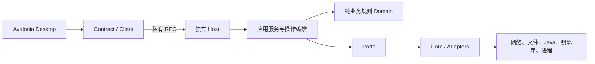

# Plain Craft Launcher Refactoring

PCL原作者：**龙腾猫跃（LTCatt）** · [支持原作者](https://meloong.com/afd/a/LTCat)。这是第三方基于PCL独立二次创作的产物，并非PCL官方版本。继续保留并使用[PCL指南](PCL-LICENCE.txt)。

**源码暂为私有，尚未满足指南的公开源码要求；本版仅作内部开发基线，不宣称已满足全部分发条件。**

面向 **Apple Silicon Mac** 的 Minecraft Java 版启动器移植项目。基于 PCL、适配后的 MeloongCore/PCLCS 和自有跨平台实现，使用 **Avalonia 桌面界面 + 独立 .NET Host**，提供版本安装、账户与皮肤、模组和整合包管理、光影配置及实例管理。

最终架构目标是 **三平台原生 UI + 共享业务核心**：macOS 使用 SwiftUI，Windows 和 Linux 分别使用各自平台的原生 UI 库（具体选型待定）。当前 Avalonia 是迁移期间的可用实现和功能对照，不是最终统一 UI。Desktop/Core 分离正是为了让三个客户端共享安装、账户、资源与启动能力。

当前内部开发版本为 **0.38**（隐私与 Git 基线仍为 **0.36.1**），目标环境为 **macOS 14+ / arm64**。这是持续开发中的移植版本，尚未与 Windows PCL2 完全等价；Intel/Rosetta、任意加载器组合和任意第三方整合包不在已验证承诺内。

## 从哪里开始

| 想了解什么 | 阅读入口 |
|---|---|
| 系统怎样工作，为什么这样分层 | [架构与设计取舍](docs/架构与设计取舍.md) |
| 各项功能由什么代码实现 | [功能实现导览](docs/功能实现导览.md) |
| 如何构建、测试和继续开发 | [开发与验证](docs/开发与验证.md) |
| 必须遵守的架构约束 | [架构规范 v1.4](docs/architecture/PCL-Mac架构规范.md) |
| 当前支持范围和未完成项 | [支持范围](docs/支持范围.md)、[0.38剩余清单](docs/0.38-剩余清单.md) |
| 逐项功能与证据 | [132项功能矩阵](docs/PCL2完整功能矩阵.json) |
| 交给其他开发者或AI | [开发交接Prompt](docs/开发交接Prompt.txt)、[Git历史说明](docs/Git历史与交接.md) |

## 当前能做什么

| 功能域 | 当前实现 | 主要边界 |
|---|---|---|
| 下载与版本 | 免登录下载安装、多版本目录、校验与修复、按元数据匹配Java、原版及多个加载器 | 游戏版本出现在目录中不代表每个组合都已实测；完整动态分片及所有安装器自动修复仍有缺口 |
| 账户与皮肤 | 微软设备码登录、刷新、正版验证、钥匙串记住登录；离线账户；玩家名获取皮肤、保存、刷新和导出 | 一个真实微软账户已有证据；第二账户切换、完整3D预览和外置账户启动仍有待办 |
| 模组与资源 | Modrinth资源浏览、多源搜索、依赖检查、管理及更新；资源包/数据包入口 | Fabric schema 0/1与version 1覆盖已接入统一规划；Fabric嵌套硬约束求解已实现；完整Quilt覆盖、可选候选软权重对齐、语言插件仍有缺口；CurseForge在线路径受密钥条件限制 |
| 光影 | Iris环境准备、光影应用/配置撤销、受管理光影ZIP卸载、带归属校验的Iris环境卸载 | 旧环境和手动文件不自动追认；自定义Fabric依赖覆盖暂拒绝环境卸载；Oculus环境卸载未实现 |
| 整合包与实例 | 多种包格式的受限导入、mrpack导出、复制/备份/恢复、升级为新副本、组件调整确认 | 任意自定义客户端、jarmods、继承链及配置语义三方合并尚未完整支持 |
| 任务与窗口 | operationId、幂等受理、取消、快照/事件、会话重连、部分安装任务安全续做；托管和独立游戏运行 | 不是所有资源/整合包任务都能在任意指令处续做；独立运行与取消策略必须按操作类型区分 |

矩阵保留 **42项已覆盖限定范围、35项实现缺口、46项定向验收、9项外部条件验收**。这些是不同工作类别，不是完成百分比；没有通过改分类或增加“子进度”来缩小缺口。

## 架构概览

下面是当前0.38的运行时调用方向，不是程序集引用图；目标原生客户端将通过各自的Client接入同一Host契约：



Desktop负责交互，Host拥有安装、账户与进程执行权。这样窗口重开不会重新执行同一任务，多个入口复用相同业务规则，凭据也不会进入UI和普通任务回执。`Domain`不引用`Ports`，外部数据由应用服务取回后显式传入。当前仍保留部分Core内的既有实现，分层不等于所有内部职责已经完全纯化。

Avalonia用于迁移过渡；Mac最终使用SwiftUI，Windows/Linux分别使用本平台原生UI。独立Contract与Host使各客户端复用同一套业务实现：Swift客户端共享协议和数据语义，不直接引用C#程序集。各平台Host和系统适配仍需分别构建与验证，当前Mac证据不代表Windows/Linux已可用。完整取舍见[设计说明](docs/架构与设计取舍.md)。

## 在Mac上构建

依赖：Apple Silicon Mac、macOS 14+、Xcode Command Line Tools、Python3、curl，以及`global.json`固定的.NET SDK **10.0.402**。

```bash
git clone https://github.com/ParadoxRin/Plain-Craft-Launcher-Refactoring.git
cd Plain-Craft-Launcher-Refactoring
bash scripts/build-handoff.sh
```

这是私有仓库，克隆需要已有访问权限。构建脚本会在缺少私有SDK时下载并校验官方SDK，编译原生桥接并发布自包含应用：

```text
artifacts/Plain Craft Launcher Refactoring 0.38.app
```

也可指定已有同版本SDK：

```bash
DOTNET="/absolute/path/to/dotnet" bash scripts/build-handoff.sh
```

首次还原需要网络。当前应用使用 **ad-hoc签名，尚未Developer ID公证**。本仓库没有自动配置或运行GitHub Actions；构建说明和本地测试结果不等于远程CI已通过。

## 验证现有实现

```bash
export DOTNET_CLI_HOME="$PWD/.cache/dotnet-home"
./.tooling/dotnet/dotnet build tests/Pcl.Tests/Pcl.Tests.csproj -m:1 -nr:false
./.tooling/dotnet/dotnet tests/Pcl.Tests/bin/Debug/net10.0/Pcl.Tests.dll --iris036 artifacts/receiver-iris-tests
./.tooling/dotnet/dotnet tests/Pcl.Tests/bin/Debug/net10.0/Pcl.Tests.dll --txn035 artifacts/receiver-resource-tests
```

使用全新的测试目录。上述套件分别为22项Iris定向测试和38项相关事务测试；HTTP替身测试不能代替真实下载、游戏渲染或世界验收。

0.36记录包含真实UI卸载、共享组件保护、卸载后启动、皮肤/账户、一个微软账户及游戏独立运行。指定`Minecraft 1.21.1 + Fabric 0.19.5 + Iris 1.8.8 + ComplementaryReimagined r5.9.3`组合完成了两次独立进程的世界保存与重进，用户确认画面、标记和位置正常。该人工世界验收与之后最终包卸载修复的二进制来源分别留证，不能扩大成全版本/全平台验收。

历史说明见[0.36验收报告](docs/0.36-Iris环境卸载与世界验收.md)。旧版本产物已退出交付，本版测试范围以[0.38验收](docs/0.38-嵌套依赖与验收.md)为准；[0.36.1验收](docs/0.36.1-内部基线与验收.md)保留为基线记录。接手者需准备自己的隔离游戏实例，不能将历史记录视作本版重新验收。

## 代码与历史

```text
src/Pcl.Desktop       Avalonia窗口与展示
src/Pcl.Contract      跨边界接口、DTO和事件
src/Pcl.Client        RPC、订阅与会话恢复
src/Pcl.Host          独立进程、组合根与协议分发
src/Pcl.Application   用例与操作生命周期
src/Pcl.Domain        纯规则与解析
src/Pcl.Ports         外部能力约定
src/Pcl.Core          现有实现及平台适配
src/Pcl.Cli           命令行入口
vendor/               已适配MeloongCore与PCLCS
scripts/              构建、架构守卫和验证工具
tests/                定向测试与真实Host/UI探针
docs/                 规范、实现说明、待办与验收
```

本仓库以0.36.1的单个初始提交和`v0.36.1`标签为基线，不继承旧仓库的Git对象、分支或标签。保留的旧版本技术文档是历史说明，不是旧软件或本版测试证据；旧二进制、交接包和历史Git包不纳入交付。

## 数据与许可

- 不上传个人账户、钥匙串、令牌、世界存档、Minecraft客户端或大型运行缓存；精选证据中的个人路径和玩家文件标识已脱敏，测试PID与结果保留。
- 源码不携带原作者的OAuth应用标识。验证微软功能需配置开发者自己的应用client ID，再登录自己的微软账号，见[开发配置](docs/微软登录开发配置.md)。刷新凭据仍由Host通过系统钥匙串管理。
- 保留微软与离线登录、皮肤、游戏独立运行；按PCL指南在启动前显示原作者赞助及正版购买劝导，赞助不解锁功能；不通过删除冲突/归属检查扩大支持范围。
- PCL上游为龙腾猫跃（LTCatt）及贡献者；所用固定提交为`6b9a50df911c9d68b69b24c979efba477fb14b67`。见[PCL许可原文](PCL-LICENCE.txt)。
- MeloongCore适配基于`98157d65c7627721c816c02e8be96ac4fe61d615`，见[Apache-2.0许可](vendor/MeloongCore/LICENSE.txt)和[第三方声明](docs/THIRD-PARTY-NOTICES.md)。本项目不将不同来源统一改标为另一种许可证。
