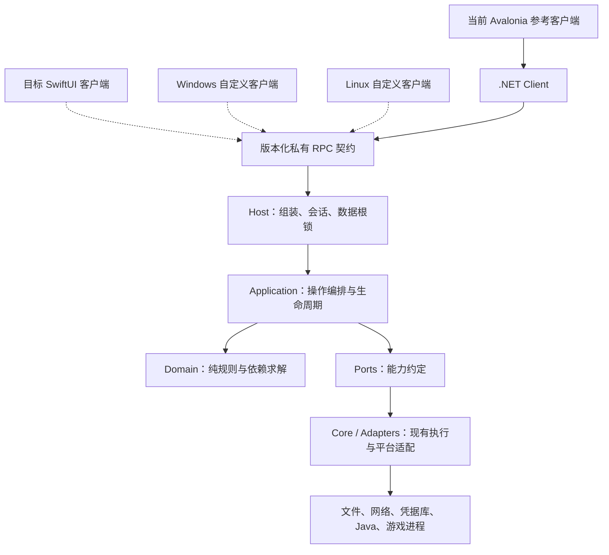

# Plain Craft Launcher Refactoring Core

PCL 原作者：**龙腾猫跃（LTCatt）** · [支持原作者](https://meloong.com/afd/a/LTCat)。这是第三方基于 PCL 独立二次创作的项目，并非 PCL 官方版本。保留并继续使用 [PCL 指南](PCL-LICENCE.txt)。应用显示名仍为 **Plain Craft Launcher Refactoring**。

项目目标是建立 **macOS、Windows、Linux 通用的 Minecraft 启动器核心**，让开发者复用安装、账户、依赖求解、资源管理和游戏进程能力，自由选择 UI 组件库、组织页面并制作自己的客户端。核心不决定控件、导航或视觉风格，客户端不复制业务规则。

当前版本 **0.41.0 Preview**：已交付的是 **Apple Silicon macOS 14+ 的 Avalonia 参考客户端 + 独立 .NET Host**。SwiftUI 是 Mac 原生客户端接入方向，Windows/Linux 的原生 UI 或其他工具包也可通过契约接入，但这些客户端和对应平台适配 **尚未完成验收**。共用代码、可编译与跨平台实际可用是三件不同的事。

源码仓库现为公开的 [Plain_Craft_Launcher_Refactoring_Core](https://github.com/ParadoxRin/Plain_Craft_Launcher_Refactoring_Core)。Git/隐私基线从 0.36.1 开始，旧历史不重新导入。

## 本版更新

- 打包此前收尾验收与修复：Apple Silicon LWJGL2 首线程崩溃、非默认实例依赖预检误用 1.21.1。
- 核心测试 231/231、依赖规划 24/24；真实 UI 的五种窗口策略、背景/音乐跟随、共享缓存和本地双节点 TCP 已留证。测试发生时间与最终包复测在发布报告中分列。
- 更新架构规范至 v1.5，区分当前引用图、运行时链路和三平台目标，补充自定义客户端接入约束。
- 本项目有权授权的原创部分采用 MIT；上游和第三方内容继续保留原许可，见 [许可范围](LICENSE.md)。

当前功能矩阵共 **131 项：68 项已覆盖限定范围、35 项实现缺口、20 项定向验收、8 项外部条件验收**。这不是完成百分比。百宝箱已按需求取消，不计为完成。菜单初始化不等于世界保存验收，旧记录也不等于本版重新测试。

## 文档导航

| 目的 | 入口 |
|---|---|
| 理解实现与设计理由 | [详细架构图和设计取舍](docs/架构与设计取舍.md) |
| 替换 UI / 开发自己的客户端 | [客户端接入指南](docs/客户端接入指南.md) |
| 查看不能破坏的边界 | [架构规范 v1.5](docs/architecture/PCL-Mac架构规范.md) |
| 找到功能执行入口 | [功能实现导览](docs/功能实现导览.md) |
| 构建、测试与发布 | [开发与验证](docs/开发与验证.md)、[0.41.0 发布记录](docs/0.41-核心平台定位与发布.md) |
| 确认完成和未完成范围 | [剩余清单](docs/剩余清单.md)、[功能矩阵](docs/PCL2完整功能矩阵.json)、[支持范围](docs/支持范围.md) |
| 接手项目 | [开发交接 Prompt](docs/开发交接Prompt.txt)、[Git 与交接](docs/Git历史与交接.md) |
| 理解开发责任与许可 | [AI 辅助开发方式](docs/开发方式与责任.md)、[许可范围](LICENSE.md)、[第三方声明](docs/THIRD-PARTY-NOTICES.md) |

## 架构概览

下图为运行时调用方向；虚线表示接入目标，实线表示当前参考实现。详细编译依赖、任务和退出时序见架构文档。



Desktop 只依赖 Contract/Client；Host 执行安装、登录和进程操作，应用服务持有任务真相。`Domain` 不引用 `Ports`，外部数据先由应用层取得再传入纯规则。非 .NET 客户端共享协议语义，不需要也不能直接引用 C# 对象。更换控件库不应更换安装事务、凭据存储或依赖规则。

## 已有能力与边界

| 功能域 | 已有能力 | 主要限制 |
|---|---|---|
| 版本与 Java | 免登录下载、多版本、多个加载器、校验/修复、按元数据匹配 Java | 不是任意加载器组合或全部快照保证；Windows/Linux 的 Java/native 路径需分别实测 |
| 账户与皮肤 | 微软设备码登录/刷新/权益验证、离线账户、玩家名皮肤获取/保存/刷新 | 一个真实微软账户有历史证据；第二账户、完整 3D 预览及外置账户启动仍有待办 |
| 模组与资源 | Modrinth、多源搜索、管理/更新、统一依赖规划、Fabric/Quilt 覆盖与嵌套硬约束 | 自定义 Quilt 插件、虚拟/多父路径、官方软偏好最优化、全部 TOML 语义仍缺；CF 在线验收需密钥 |
| 整合包与实例 | 受支持包格式导入、mrpack 导出、备份/恢复、新副本升级、组件调整 | 任意自定义客户端、jarmods、继承链、配置语义三方合并及跨启动器兼容未完整覆盖 |
| 光影 | Iris 环境、配置撤销、受管理 ZIP/环境卸载与共享依赖保护 | 旧环境/手工文件不追认；覆盖配置下卸载拒绝；Oculus 环境卸载未实现 |
| 任务与运行 | 幂等受理、取消、快照/事件、会话重连、部分安全续做、独立游戏运行 | 不是任意任务断点续做；本地双节点 TCP 不代表互联网 NAT 或双玩家世界 |

## 构建与使用

```bash
git clone https://github.com/ParadoxRin/Plain_Craft_Launcher_Refactoring_Core.git
cd Plain_Craft_Launcher_Refactoring_Core
bash scripts/build-handoff.sh
```

Mac 打包依赖 Apple Silicon、macOS 14+、Xcode Command Line Tools、Python 3、curl 和 `global.json` 固定的 .NET SDK 10.0.402。脚本缺少 SDK 时下载并校验，可用 `DOTNET=/absolute/path/to/dotnet` 指定同版本 SDK。

输出：`artifacts/Plain Craft Launcher Refactoring 0.41.0.app` 和同版本 macOS arm64 ZIP。当前使用 **ad-hoc 签名，未进行 Developer ID 公证**。源码可供其他平台继续适配，本次不发布未经验证的 Windows/Linux 可运行包。`release.json` 是打包版本入口，Desktop 的项目版本需与其一致，构建脚本会核对。

```bash
export DOTNET_CLI_HOME="$PWD/.cache/dotnet-home"
./.tooling/dotnet/dotnet build tests/Pcl.Tests/Pcl.Tests.csproj -m:1 -nr:false
./.tooling/dotnet/dotnet tests/Pcl.Tests/bin/Debug/net10.0/Pcl.Tests.dll artifacts/receiver-core-tests
```

使用全新隔离目录；测试是控制台程序，不能以 `dotnet test` 未报错代替运行。详见[开发与验证](docs/开发与验证.md)。

## 开发方式

本项目**大量使用 AI 辅助编码**。**架构决策、功能取舍、边界判定与验收由人工负责；代码由 AI 生成并经人工审查。** AI 也用于分析、测试探针和文档整理。该声明描述开发责任与工作方式；具体人工审查和验收范围以记录为准，不表示每条历史路径均已人工执行或逐行复核。参见[开发方式与责任](docs/开发方式与责任.md)。

## 数据、兼容与许可

凭据沿用 `IAccountSecrets` 留在 Host/系统凭据库，不进入 Shell、receipt、设置导出或普通事件。内置的是应用所有者授权的**公开 OAuth client ID**，不是 client secret；用户使用自己的微软账号。派生产品可配置自身获准 ID，见[微软登录开发配置](docs/微软登录开发配置.md)。

保留数据根、bundle/钥匙串身份，微软/离线登录、皮肤和游戏独立运行行为。保留 PCL 作者署名、赞助与正版购买劝导；赞助不解锁功能，Windows 蓝色限制不因自定义客户端取消。

**原创部分 MIT + 上游/第三方各自许可**，不是全仓统一 MIT。详见 [LICENSE.md](LICENSE.md)、[MIT 文本](LICENSE-MIT.txt)、[PCL 原文](PCL-LICENCE.txt)。不上传个人账户、令牌、世界存档、Minecraft 客户端、私有 SDK 缓存或原始敏感日志。
