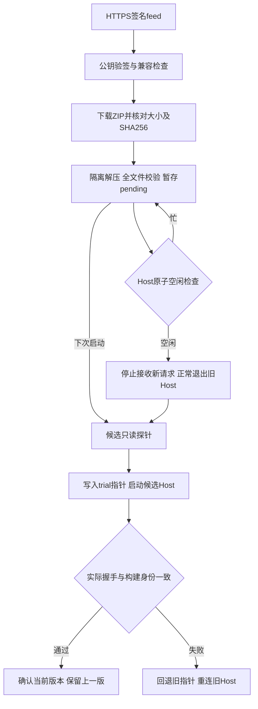

# Host 自动更新与客户端接入

本能力更新的是独立核心 Host，不替换客户端 UI，不迁移账户或游戏目录。它在 main 源码中实现；既有 v0.41.0 安装包不会因此自动拥有更新能力。测试中的 0.42.0/0.43.0 是候选夹具版本，不是正式发布声明。

## 部署与信任

- Client/Contract 提供更新 SDK；无需引用 Core。Host 增加 `host.update.prepare.v1`、hello 的可选 `build` 字段与 `--update-probe`。
- 客户端发布者决定可信公钥、feed 地址、频道、版本下限、数据格式及所需能力。默认不联网检查更新；没有策略文件时仍使用随包 Host。
- 没有内置临时测试私钥或测试服务器；本次不建立未经运营准备的官方签名频道。发布者需自行保管私钥、上传签名 feed/ZIP 并配置可信公钥后启用自动接收。
- 更新器不从 feed 获取新的信任根，不传微软令牌或数据目录给更新网站。签名用 RSA-PSS/SHA-256（至少2048位）；清单签名涵盖版本、平台、协议、能力、数据格式、有效期、下载URL及文件清单。参见 [.NET RSA](https://learn.microsoft.com/en-us/dotnet/api/system.security.cryptography.rsa?view=net-10.0)。
- 默认传输只允许HTTPS；显式验证最多5次重定向，适用于GitHub Release/CDN。客户端注入自定义HttpClient时，它是受信任传输：也必须禁用未经验证的隐式重定向。测试使用受控传输夹具，不是公开CDN可用性证明。

## 使用 SDK

在第一次连接前配置，更新存储必须是本用户私有目录，并与该客户端的数据根一一绑定：

```csharp
await using var client = new HostClient(dotnetPath, bundledHostDll, dataRoot, reconnectable: true);
client.ConfigureUpdates(new HostUpdatePolicy(
    FeedUrl: "https://your-release-site.example/stable/osx-arm64/feed.json",
    PublicKeyPem: trustedPublisherPublicKey,
    Channel: "stable",
    MinimumSequence: 41000,
    DataEpoch: 1,
    Protocol: 1,
    RequiredCapabilities: ["desktop.contract-only.v1", "host.update.prepare.v1"],
    ApplyWhenIdle: true), privateUpdateDirectory);
await client.HelloAsync();
await client.CheckForUpdatesAsync();          // 下载、验证、暂存，不停当前 Host
await client.ApplyUpdateWhenIdleAsync();     // 忙时返回 HOST_BUSY，保留候选
```

`LauncherSession` 自动持有检查循环：立即检查，之后默认每6小时检查一次；有候选时每60秒尝试空闲应用。退出先取消并等待更新循环，再关闭原业务会话；不启动无人持有的后台任务。仅使用HostClient的自定义客户端可以自行调度上面两个方法，查询 `UpdateStatus` 展示结果；不必使用参考客户端的周期。

`ApplyWhenIdle=false` 只限制自动循环，候选在下次无既有Host的启动时应用；用户显式调用Apply仍可请求空闲应用。下载或更新检查失败保留旧 Host，自动循环暴露固定错误码，供界面提示；不向UI回传远端原始异常正文。

参考Avalonia客户端读取应用目录的 `host-update-policy.json`（应在客户端签名前部署）。它将更新安装在用户LocalApplicationData下按应用路径和数据根哈希区分的目录，不改签名.app内部Host。没有文件时不配置更新。

示例策略（PEM必须替换为发布者真实公钥，不要原样使用占位值）：

```json
{
  "FeedUrl": "https://your-release-site.example/stable/osx-arm64/feed.json",
  "PublicKeyPem": "-----BEGIN PUBLIC KEY-----\n...\n-----END PUBLIC KEY-----",
  "Channel": "stable",
  "MinimumSequence": 41000,
  "DataEpoch": 1,
  "Protocol": 1,
  "RequiredCapabilities": ["desktop.contract-only.v1", "host.update.prepare.v1"],
  "ApplyWhenIdle": true,
  "CheckIntervalSeconds": 21600
}
```

最小客户端增加 `--update-policy <文件> --update-store <私有目录>`，交互命令为 `update-check`、`update-apply`、`update-status`。该示例手动驱动检查，展示SDK接线；参考客户端由LauncherSession自动调度。

## 状态与安全切换



1. 校验频道、当前OS/CPU、精确协议版本、所需能力及数据epoch。自动更新只接受现有epoch=1，不执行数据迁移。跨epoch升级必须设计独立备份/迁移方案。
2. 最高已接收序号和内容身份持久化，拒绝降级及同序号不同清单。清单有效期最多90天；已验证安装版本不因feed过期而不能离线启动。发布清单应不可变，修订需要递增序号。
3. ZIP和解压总量/文件数有限制；逐文件校验长度与SHA256，拒绝路径穿越、大小写碰撞、链接/特殊文件及清单外文件。再次启动时重验文件，检测暂存/安装后篡改。默认包上限2GiB、展开4GiB、10000文件；路径只支持受限ASCII发布文件名。
4. 更新存储用OS独占锁，不以PID或TTL夺权；state指针先在同目录写临时文件并Flush，再替换，不覆盖运行中的二进制。内存状态仅在持久化成功后变更。参考[File.Move说明](https://learn.microsoft.com/en-us/dotnet/api/system.io.file.move?view=net-10.0)。这里测试的是进程崩溃，不宣称硬件断电下目录元数据一定持久。
5. Host在串行请求循环中同时判断空闲和停止受理。安装、页面写任务、登录/皮肤任务、已知托管或独立游戏、联机节点均会推迟更新。不通过主动取消任务达到空闲，不强杀旧Host。
6. 候选先执行无数据目录的probe，再连接实际Host验证hello构建信息和能力。trial持久化早于业务启动，未确认即客户端崩溃，下次回退；启动失败只终止本次候选Host，不杀进程树、游戏或其他用户进程。失败候选不自动反复尝试。
7. 自动回退限定在启动/握手阶段；不是长期运行的任意业务故障回退。签名只是发布者声明，不证明任意新代码都正确；epoch相同的发布者仍有保持数据兼容的责任，必须先测试。
8. 更新窗口中的新客户端请求可能收到 `HOST_UPDATE_IN_PROGRESS`；UI等待重连后刷新状态。请求超时或响应丢失仍遵循原幂等契约，不能生成新键盲目重发。

独立游戏继续拥有自身输出文件和运行进程，不依赖旧Host存活。旧Host已知游戏运行时不在线切换；正常退出Host后，下次启动可应用候选且不终止旧游戏。重启不重新接管旧独立游戏，是既有边界；不宣称更新器解决了跨Host的游戏进程注册。原日志脱敏/大小限制缺口也不由本次更新修复。

## 制作发布包

发布工具 `tools/Pcl.UpdatePack` 不依赖Core。建议生产发布自包含包，避免客户端机器缺.NET；framework-dependent包也支持，但客户端必须提供能运行该Host的dotnet。签名包不能自动安装或替换系统.NET。

```bash
dotnet publish src/Pcl.Host/Pcl.Host.csproj -c Release -r osx-arm64 \
  --self-contained true -p:Version=0.42.0 -p:HostUpdateSequence=42000 -o /tmp/pcl-host-publish
# 完成原生文件install_name检查、平台签名/公证（若采用）后再生成probe和包。
/tmp/pcl-host-publish/Pcl.Host --update-probe > /tmp/pcl-host-probe.json
dotnet run --project tools/Pcl.UpdatePack -c Release -- \
  /tmp/pcl-host-publish /tmp/pcl-host-probe.json Pcl.Host \
  https://your-release-site.example/stable/osx-arm64/host.zip stable \
  /secure/path/release-private-key.pem /tmp/pcl-host-delivery
```

输出 `host.zip`、签名 `feed.json` 和公钥。私钥路径仅在发布机使用，不能加入Git、CI日志或Release附件。先上传不可变ZIP，再更新feed；为不同RID提供不同feed。公钥预先随客户端交付，不从此次下载包信任公钥。此签名不代替Apple Developer ID、公证或Windows代码签名。

不自动删除旧版本，避免运行中删除或失去回退路径；版本存储清理、签名密钥轮换、增量补丁、分批发布、UI自身升级和词库独立更新仍是后续工作。

## 复验

CI使用framework-dependent发布夹具，并在三平台实际运行更新测试：

```bash
dotnet publish src/Pcl.Host -c Release --no-self-contained -o artifacts/update-old -p:Version=0.41.0 -p:HostUpdateSequence=41000
dotnet publish src/Pcl.Host -c Release --no-self-contained -o artifacts/update-new -p:Version=0.42.0 -p:HostUpdateSequence=42000
dotnet build tests/Pcl.HostUpdates.Tests -c Release
dotnet tests/Pcl.HostUpdates.Tests/bin/Release/net10.0/Pcl.HostUpdates.Tests.dll \
  artifacts/update-old artifacts/update-new artifacts/update-fresh-root artifacts/update-result.json
```

测试使用临时RSA密钥、受控HTTP传输响应和真实Host；合成账户不进行微软认证。所有输出根必须全新。可选第五参数为先经 `Pcl.MinimalClient.Tests live` 准备、且带 `.host-update-game-fixture` 标记的本轮隔离游戏根，用于实际试玩渲染及Host切换期间进程存活；禁止指向个人实例。
