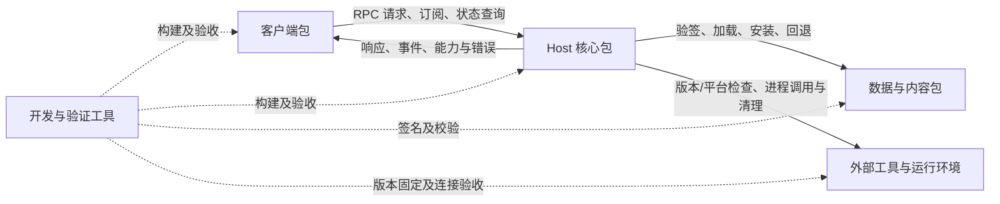

# PCLCS 五类包连接规范

规范版本：1.0；日期：2026-11-02。适用基线：0.42.1、客户端 build 425、Host 序号 42102、数据序号 42102、核心提交 `81016b4`。基线用于定位实现，不要求未来所有包同步升级版本。

本规范约束【客户端包】【Host 核心包】【数据与内容包】【外部工具与运行环境】【开发与验证工具】之间的连接，不要求进一步拆分核心内部程序集。本文中的“必须／不得”为接入和发布要求；“当前实现”与“验收要求”分别表示已有机制和必须执行的验证，不表示每条要求都有自动守卫。

具体消息字段以 [Contract](../src/Pcl.Contract/)、Host 分发与对应签名模型为准。本文不是新增协议、通用插件机制或已经发布的跨语言 SDK。修改这些接口时，必须同时修改实现、规范及连接测试。

## 1. 包归属与所有权

| 包 | 包含内容 | 拥有的状态和行为 | 不得承担 |
|---|---|---|---|
| 客户端包 | UI/CLI、Client SDK、配套 Contract、客户端自更新模块和运行助手 | 展示状态、请求关联、订阅、重连、客户端部署及其更新缓存 | 直接构造 Core/Application 业务实现；自行修改 Host 的账号、实例、任务或内容状态 |
| Host 核心包 | Host、Application、Domain、Ports、Core、Legacy、必要上游实现、配套 Contract；自包含部署的 .NET 运行时 | 业务校验、数据根锁、持久化、凭据、任务及受托管工具进程 | 依赖特定 UI；让客户端重复实现安装、登录或依赖求解 |
| 数据与内容包 | 当前百科/项目映射签名 JSON 数据 | 提供版本化静态内容及来源信息；安装状态由 Host 一侧管理 | 包含或执行客户端/核心代码；改变凭据与游戏数据格式 |
| 外部工具与运行环境 | 游戏 Java、EasyTier、固定游戏兼容运行资产 | 提供可执行能力，由 Host 选择、验证和调用 | 自行获得 Host 的数据根写入权；由 UI 绕过 Host 启动业务进程 |
| 开发与验证工具 | 构建、签名、导出、诊断、测试程序与脚本 | 生成并验证上述交付；维护测试证据 | 成为用户启动产品的前置依赖；将发布私钥放入任何交付包 |

Client SDK 属于客户端接入资产，不构成第六种用户更新包。Contract 在两端各携带兼容版本，不单独替换 DLL。更新助手虽然在 `tools/Pcl.ClientUpdater` 构建，其运行产物属于客户端包。完整 `.app` 可以组合客户端和 Host，但客户端源码不得因此重新依赖 Host。

## 2. 连接矩阵

下图箭头表示运行中的访问或交付关系，不表示 C# 编译引用方向。



| 连接 | 唯一业务入口 | 载荷/媒介 | 结果确认 |
|---|---|---|---|
| 客户端 → Host | 私有管道 RPC；stdio 为直接进程/测试入口 | UTF-8 NDJSON；Contract 请求、响应、事件 | attach/hello、能力、任务终态、订阅快照 |
| Host → 数据 | `ContentPack` / `ActiveContentIndex` / `ContentUpdates` | 可信策略、签名内容文档、独立内容存储 | 验签及适用版本通过；Host 重启后活动序号与搜索结果正确 |
| Host → 外部工具 | 核心已有 Java/EasyTier 等适配器 | 工具路径、版本/架构、参数、进程输出 | 检查结果、实际运行/通信、退出与资源释放 |
| 客户端更新器 → Host 候选 | Client 的 Host 更新 SDK | 预置策略、签名 feed、Host ZIP、探针 | 空闲切换后实际 hello 与声明一致；失败回退 |
| 客户端 → 自身更新助手 | 客户端更新模块内部安装事务 | 已验证候选、安装请求、启动确认 | 等待旧客户端退出、替换、重启确认或恢复旧版本 |
| 开发工具 → 交付物 | 现有构建/签名/校验脚本 | 文件、清单、独立公钥及测试报告 | 实际产物验签、哈希校验、包间连接验收 |

客户端经 Host 获取数据搜索结果和工具状态，不直接读取内容存储实现或启动 EasyTier。管理员可用内容工具在明确的部署流程中安装/回退数据，但这不是普通客户端旁路；活动 Host 的索引仍到下次启动才切换。

## 3. 客户端与 Host 的接入约定

### 3.1 构建与部署

.NET 客户端业务接入仅引用 Client/Contract；Mac 自更新模块另属客户端。其他语言实现同等协议语义，不要求加载 .NET DLL。Host 不依赖 Desktop、CLI 或 Client 传输实现。

部署方必须明确 Host 位置和独立数据根，不依赖源码目录布局或当前工作目录猜测：

| 配置 | 当前用途 |
|---|---|
| `PCL_HOST_EXECUTABLE` | Desktop 指定外置自包含 Host；路径不存在时失败 |
| `PCL_HOST_ASSEMBLY` + `PCL_DOTNET` | Desktop 指定 framework-dependent Host 与兼容的 dotnet |
| 随包 `host/` | 完整安装器的默认 Host 部署位置 |
| CLI `--host` 或 `--host-assembly`，以及 `--data-root` | 正式 CLI 的显式部署参数；两种 Host 形式二选一；FDD 可指定 `--dotnet` |
| `PCL_CONTENT_ROOT` / `PCL_CONTENT_POLICY` | Host 内容存储与预置可信策略覆盖；未指定时采用实现的默认位置 |
| `PCL_CLIENT_UPDATE_ROOT` | 客户端更新存储位置覆盖；不是游戏或账号数据根 |

配置由部署方提供，不能转化为普通 RPC 中任意路径、公钥或更新源的自由输入。自包含 Host 携带自己的 .NET；framework-dependent Host 要求部署方提供兼容 .NET。游戏 Java 与 .NET 是不同的运行环境。

### 3.2 连接建立

1. 明确数据根，连接或启动对应 Host。操作系统独占锁决定数据根所有权；不得凭 PID 文件或超时擅自夺锁。
2. 私有管道模式必须先 `session.attach`，验证 `clientId`、`processId`、`startedUtcTicks`。Linux 另需 `linuxStartTicks`；字段语义见[接入指南](客户端接入指南.md)。stdio 直接模式先 hello。
3. 调用 `host.hello`，确认协议版本、`hostInstanceId`、能力、帧大小及安装目标；使用更新功能时还需核对 `build`。
4. 只有协议和目标功能能力满足后才发送业务请求。能力缺失应明确提示或禁用对应功能，不得静默改为本地 Core 调用。
5. 建立订阅并恢复权威快照；断线重连后重新处理订阅水位和状态，不沿用旧连接的请求关联。

当前 hello 示例（仅适用于已满足相应传输握手前置条件时）：

```json
{"protocolVersion":1,"id":"0123456789abcdef0123456789abcdef:1","method":"host.hello","params":{"minimumVersion":1,"maximumVersion":1}}
```

这是 PCL 自定义 RPC，不声明 JSON-RPC 2.0 兼容。同一连接请求 ID 使用 32 位 GUID 前缀与从 1 连续递增序号；重连换前缀。遵守 hello 的 `maximumFrameBytes`；协议输出与诊断日志分离。`version.install.v3` 等是能力名，不是方法名。

### 3.3 请求、任务与资源生命周期

- 安装、页面任务、账号及游戏按各自 Contract 调用。`requestId`、`idempotencyKey`、`operationId`、`instanceId`、`gameProcessId` 不得混用。
- 已受理任务通过 operationId 查询；网络超时不等于任务取消。重试遵守原幂等键和参数，禁止通过换键盲目制造重复业务。
- 取消视图只释放视图资源；取消后台业务必须显式请求并等待终态。Host 重启后查询已持久化状态，仅对支持续做的任务续做。
- 事件出现缺口、断连或背压时重新取快照；大资源通过 blob 句柄有界读取并释放。
- 同一数据根保持单写入会话。支持多个客户端实现，不代表支持多个独立 Host 并发写同一数据根；本规范不新增共享多写或多租户语义。
- 微软令牌和长期凭据不得进入 RPC 返回、客户端设置、日志或交付清单。凭据由 Host 的平台秘密存储适配管理。

## 4. Host 与数据/内容包

当前模型见 [ContentPack.cs](../src/Pcl.Core/Adapters/Content/ContentPack.cs)。仅支持已定义的 `wiki-project-index` 类型，不把任意 JSON 当作可安装内容。

| 字段 | 约定 |
|---|---|
| `Format` / `Kind` | 当前格式 1，内容类型必须受实现支持 |
| `Channel` / `Sequence` | 匹配预置频道；内容序号独立递增并保留防重放状态 |
| `MinHostVersion` / `MaxHostVersion` | Host 版本必须落在适用范围内 |
| `Provenance` / `Entries` | 来源说明与内容记录；当前记录含百科 ID、标题、来源站点映射及热度 |
| `Payload` / `Signature` | envelope 内的 Base64 载荷与 RSA-PSS/SHA256 签名；验证原始载荷字节 |

信任根来自预置 `ContentPolicy`，不来自下载包。单包最多 16 MiB。当前自动下载使用 HTTPS、禁止重定向、有超时与大小限制；旧策略没有 FeedUrl 时保持离线行为。

客户端仅调用 `content.update.status` / `content.update.begin`，且须先确认 `content.update.v1`。客户端不得传入任意下载地址或新的可信公钥。Host 后台单次检查，状态查询必须仍可响应。

安装成功不意味着当前索引立即切换：分别显示 `activeSequence` 与 `installedSequence`，下次 Host 启动激活。验收必须检查真实搜索结果，不能只检查“文件已下载”或序号变化。

签名、格式、版本或下载失败不得破坏既有有效选择。损坏/不适用内容按当前加载器策略使用可验证的上一版或内置索引；显式回退保留防重放高水位。清理仅删除受管理的过期内容，保留活动、回退及状态文件，不进入账号/实例目录。详见[数据分包](0.42.1-数据分包.md)和[更新与清理](0.42.1-统一更新与清理.md)。

## 5. Host 与外部工具/运行环境

当前采用各工具自己的元数据、固定版本与校验路径；没有通用的“工具插件 RPC”或覆盖全部工具的统一签名清单。新增工具应复用 Host 的受控执行路径，不能假设现有运行环境管理器能自动管理它。

| 工具 | Host 接入责任 | 连接验收 |
|---|---|---|
| Java | 检测真实可执行文件的主版本和 CPU 架构，按游戏需求选择；自动获取遵守现有元数据校验和安全解包流程 | 经 `workspace.java.inspect` / `workspace.java.discover` 获取结果；有效与缺失路径；失败后 Host 仍可服务 |
| EasyTier | 固定版本/平台、归档大小与 SHA-256，安全解压，由 Host 创建和停止节点 | 两节点连接、真实 TCP 往返、重连保留房间、关闭后监听释放；邀请凭据不落普通状态文件 |
| 固定兼容资产 | 生成或获取时固定版本/哈希，打包时验证，运行路径由核心决定 | 检查实际交付资产完整性，并对涉及的游戏路径单独运行验收 |

工具缺失、架构错误、校验失败或启动失败必须由 Host 返回可识别失败，客户端不得绕过检查直接启动。界面只表达用户意图和展示结果，版本选择与启动权限仍由核心权威判断。

停止业务时按进程所有权清理；不得杀死无关进程树。游戏的托管/独立生命周期与 EasyTier 等节点生命周期分别处理，不能以客户端退出为理由杀死所有子进程。工具安装目录与用户实例数据分离，运行中的工具不得原地被替换。

## 6. 版本兼容与更新事务

### 6.1 独立版本轴

| 版本轴 | 当前基线 | 判定用途 |
|---|---|---|
| 产品版本 / 客户端序号 | 0.42.1 / 425 | 客户端交付身份、自更新顺序 |
| Host 版本 / 序号 | 0.42.1 / 42102 | 核心候选身份、最低版本与防降级 |
| 协议 / 能力 | RPC 1；能力集合由 hello 返回 | 消息兼容与具体功能可用性 |
| 数据 epoch | 1 | Host 持久化兼容；当前自动更新不跨 epoch 迁移 |
| 内容格式 / 序号 | 1 / 42102 | 内容解码与防重放，另校验 Host 版本范围 |
| 工具版本 / 平台 | 各工具单独声明 | 真实工具运行兼容；不与 Host 序号共用计数 |

序号属于各自更新域，不能比较客户端 425 与 Host 42102 来判断兼容。语义版本相同也不能代替协议、能力、OS/CPU、epoch 和策略检查。不可覆盖已发布同序号的不同字节资产；候选内容变化必须按对应发布规则递增序号。

客户端与 Host 独立更新前必须验证旧客户端＋新 Host、新客户端＋旧 Host，以及不兼容时的明确拒绝。发布清单中的兼容声明只是发布者承诺，还必须经过实际连接测试。

### 6.2 更新责任和失败处理

| 对象 | 执行者 | 安全切换点 | 成功条件 | 失败路径 |
|---|---|---|---|---|
| Host | 客户端 Host 更新 SDK；Host 原子判断是否空闲 | 暂存后经 `host.update.prepare`，忙时推迟；不强制取消业务 | 探针通过、新 Host 实际 hello 与签名声明一致 | 启动/握手阶段回退旧指针并重连，失败候选不反复尝试 |
| 客户端 | 客户端更新模块与独立助手 | 校验候选、等待原客户端退出后替换 | 新客户端启动确认，保留回退备份 | 退出超时不杀旧客户端；启动失败/超时恢复旧版本 |
| 数据 | Host 内容更新器 | 暂存/验证/安装；下次 Host 启动激活 | 活动序号和真实数据查询正确 | 保留既有有效内容或使用验证过的回退/内置内容 |
| 外部工具 | Host 对应适配器 | 具体工具的受控安装/启动流程 | 校验、版本/架构检查及调用成功 | 保持业务失败可诊断，不启动未经校验的替代文件 |

Host 自动更新需要同时匹配频道、平台、精确协议、所需能力、数据 epoch、最低/最高已接受序号。回退保证针对启动/握手阶段，不承诺对任意后续业务故障自动回滚数据。

客户端更新类型分 `client-directory` 与 `macos-app`，各用自己的 feed，不可混用。更新策略的信任根不得被候选静默替换；当前允许 Host 最低序号提高，拒绝降低和无授权信任变更。完整机制见 [Host 更新](Host自动更新与接入.md)与[客户端自更新](0.42.1-客户端自更新.md)。

### 6.3 多包升级顺序

当前没有跨五类包的一次性原子事务。发布方必须安排可逐步运行的兼容组合：

1. 先生成兼容清单和测试矩阵；按新功能需要确认 Host、客户端、内容及工具的最小组合。
2. 需要新 Host 能力时，先暂存并验证新 Host，待空闲切换成功再让客户端依赖该能力；旧客户端须仍可连接新 Host。
3. 客户端升级后再显示依赖新能力的入口。若反向部署顺序也可能出现，新客户端必须能连接旧 Host 并明确降级或拒绝该功能。
4. 内容包只在适用 Host 上安装；不通过内容包触发隐式核心升级。工具在受控业务流程中准备并校验。
5. 任一步失败，停在已验证兼容的组合；不得继续盲目推进其他包。没有过渡兼容组合时采用另行设计的协调升级流程，不能宣称现有独立更新器已经支持。

## 7. 发布清单、路径和信任

统一索引由现有发布脚本生成，包含版本、频道、runtime、包文件名、长度、SHA-256、不可变下载地址、签名引用及对应兼容声明。Host 与客户端另有各自签名 feed；内容为独立签名 envelope。字段模型分别见 [HostUpdates.cs](../src/Pcl.Contract/Updates/HostUpdates.cs)、[HostUpdateStore.cs](../src/Pcl.Client/Updates/HostUpdateStore.cs)及[ClientUpdatePackage.cs](../src/Pcl.Desktop.Updates/ClientUpdatePackage.cs)。JSON 大小写与线格式按对应序列化实现，不将本文表格当作可直接发送的完整消息。

发布者先上传不可变资产，验证实际可下载字节及签名，再切换稳定 feed。公钥须由可信安装或配置预置；同下载目录的公钥只作审计，不自动建立信任。私钥只存在于受控发布环境。当前测试密钥和 `updates.example` 地址不是生产更新源。

部署、更新缓存、内容存储、Host 数据根、工具运行目录必须有明确所有者；清理器只处理自身目录。具体平台默认路径由实现计算，第三方客户端不应复制内部哈希目录算法，优先通过 SDK 指定私有存储。Host 更新安装在独立存储，不原地修改签名 `.app` 内的 Host。任何候选路径都必须通过现有解包/链接/穿越校验；不能用 UI 确认替代校验。

## 8. 开发工具与连接验收门槛

开发诊断工具可直接引用核心，但必须使用隔离数据根，不得与运行中的 Host 争写同一目录。工具源码留在开发工作区；用户运行只需要已发布的产品与运行资产。构建成功、文件存在、哈希正确分别是不同证据，均不能单独代表连接成功。

| 改动涉及 | 必须验证 | 现有入口 |
|---|---|---|
| 客户端/SDK/Host 协议 | 独立编译、hello/能力、不兼容拒绝、重连、幂等、任务终态、账号状态及退出 | `test-independent-clients.sh`、`Pcl.MinimalClient.Tests`、已验收图形客户端 |
| Host 更新 | 实际签名包、空闲切换、候选握手及失败回退 | `Pcl.ComponentDelivery.Tests`、`Pcl.HostUpdates.Tests` |
| 客户端更新 | 验签、等待退出、实际替换/重启、损坏及超时回退、外置 Host 重连 | `test-client-self-update.sh` |
| 内容与缓存 | 签名/兼容/防重放、重启激活、真实搜索、回退与保留规则 | `Pcl.ContentPack.Tests`、`Pcl.UpdateIntegration.Tests` |
| 外部工具 | 真实 Java 检查、失败后仍可连接、真实节点传输与生命周期 | `test-package-connectivity.sh` |
| 发布和包边界 | 统一清单、实际 ZIP、签名/错误密钥/哈希拒绝、源码与 IL 边界 | `build-unified-release.sh`、`test-unified-release.py`、`check-module-boundaries.py`、ArchitectureGuard |

测试报告必须记录版本/序号、平台、实际产物身份、运行范围、结果及未覆盖内容。HTTP 替身不算生产 HTTPS/CDN 验收，本地两节点不算互联网 NAT 或双人世界验收。

当前五类包的本地 Mac 连接性结果见[收尾报告](0.42.1-五类分包收尾.md)和[验收数据](0.42.1-五类分包收尾验收.json)。这些结果不证明所有未来版本、所有 Java 版本、Windows/Linux 或生产签名发布均已验收。

## 9. 接入方交付检查表

- [ ] 明确客户端部署、Host 入口、数据根、内容目录及更新存储的所有者。
- [ ] 完成 attach/hello、协议/能力判断，不在客户端保留业务执行旁路。
- [ ] 明确任务、订阅、取消、重连与进程退出的生命周期。
- [ ] 配套携带 Contract，独立固定 Host/客户端/内容的可信更新策略。
- [ ] 校验内容和工具的适用版本、平台、完整性；失败保持现有有效状态。
- [ ] 发布前验证升级过渡组合和回退，确认没有隐含的跨包原子事务假设。
- [ ] 使用已通过测试的客户端连接最终交付 Host，并保存相应验证证据。
