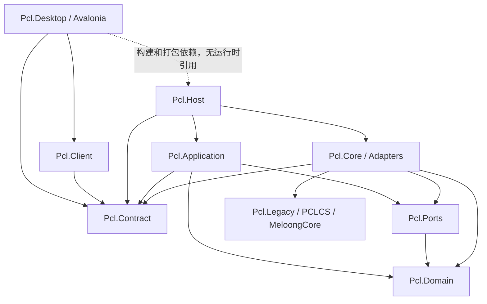
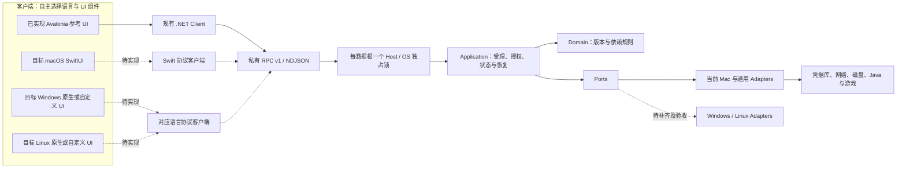
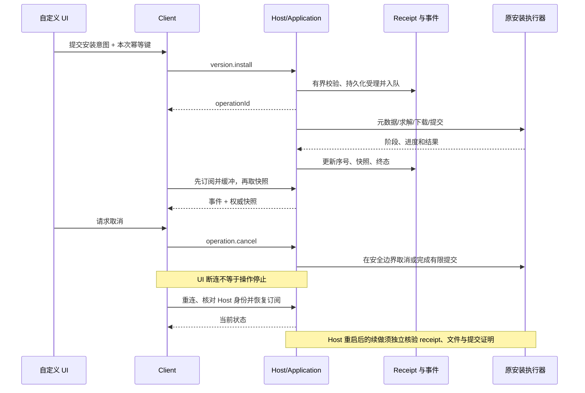
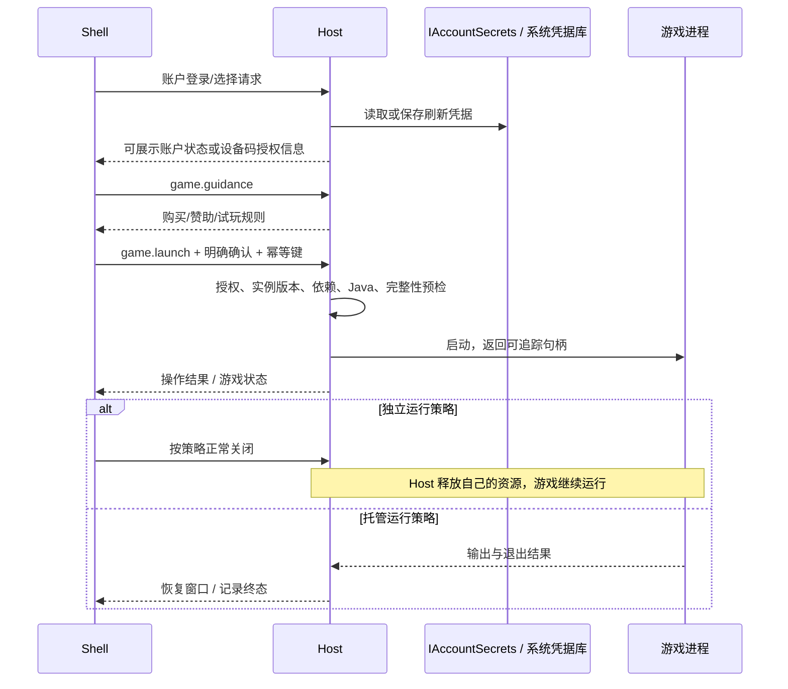

# 核心平台架构与设计取舍（0.41.0）

目标是三平台可复用的启动器核心与可替换客户端。本文按当前源码区分**已经落地的 .NET 模块**、**目标平台适配**和**尚未实现的客户端**；约束见[架构规范 v1.5](architecture/PCL-Mac架构规范.md)，行为证据见[本版发布记录](0.41-核心平台定位与发布.md)与[收尾第五批](收尾第五批验收.md)。

## 1. 当前编译依赖：箭头表示引用

图依据实际 csproj，省略 NuGet 标准依赖和测试工具。`Core` 不引用 `Application`，实现 Port 后由 Host 注入应用服务；Domain 不引用 Ports 或 UI。Desktop 的 Host 引用设置 `ReferenceOutputAssembly=false`，仅用于构建与打包。Host 业务 DLL 位于应用 `host/` 子目录，不能因为在同一包内就让 UI 直接引用它们。

`Pcl.Core.Contracts` 等历史命名空间不等于它仍编译在 Pcl.Core.dll 中，应以项目归属和符号守卫为准。Core 仍包含较多既有执行服务，不等于全部代码已拆成最小适配器。CLI 有历史直接 Core 调用，不是给新 Shell 的例外。

## 2. 部署与运行时：UI 可替换，执行权集中

同一套核心源码按平台构建部署，不是让一个 Mac 二进制运行在所有系统上。当前 Host 组合根仍直接组装 KeychainAccountSecrets，窗口桥接和打包脚本也针对 macOS；因此不能把 net10.0 或抽出 Ports 当作 Windows/Linux 已支持的证明。

现有 .NET Client 封装私有管道、请求关联、事件与重连；stdio 可用于 CLI/测试。非 .NET 客户端需要自己的传输实现，不能只照一个 JSON 示例就声称完整兼容。当前没有通用 C ABI、跨语言 SDK 自动生成器或任意插件加载系统；UI 可替换来自协议边界，而不是未经实现的插件市场。

## 3. 数据与责任边界

| 模块 | 拥有的职责/状态 | 不能承担的职责 |
|---|---|---|
| Shell / UI | 控件、主题、导航、选中状态、视图订阅、用户确认、系统文件选择器 | 唯一依赖规则、Java 选择、令牌存储、写安装目录 |
| Contract | 请求/结果/事件、错误码、能力和版本 | 服务实例、进程句柄、原始异常、凭据 |
| Client | 关联请求、限长帧、连接/订阅/重连、DTO 映射 | 重新实现下载/安装、因超时直接重复副作用 |
| Host | 组合根、数据根锁、平台 Adapter 选择、会话和关闭协调 | 页面布局或反向引用 Shell |
| Application | 用例授权、幂等、operationId、取消/状态、恢复判定 | 创建平台具体实现或 UI 控件 |
| Domain | 显式输入的兼容、约束、计划、纯解析/比较 | 文件/网络/时间/宿主探测等隐式外部访问 |
| Ports | 短命令、长进程、凭据和其他外部能力约定 | 具体技术实现或反向引用应用编排 |
| Core / Adapters | 现有安装器、下载、文件事务、系统凭据与进程操作 | 绕过 Host 向 UI 交出任意执行权 |

外部数据由 Application 经 Ports 取得后传给 Domain。内部 Port 可以返回需要明确释放责任的流或句柄；跨进程 DTO 不可以。数据根、bundle 与钥匙串身份不随项目改名变化。

## 4. 安装、取消、重连与安全续做

继续复用 `InstallOperations -> VersionInstaller`，不为换 UI 重写安装链。幂等键按数据根和命令划域，与输入指纹绑定；版本号不能成为所有尝试共用的键。受理前不完成远程下载，失败也必须可查询。

会话恢复是恢复展示和连接；任务续做是验证文件与阶段后继续执行。原版和支持加载器已有安全恢复路径，资源/整合包任务并非任意位置可续做，未知提交状态拒绝盲目重放。receipt 不存秘密或无限日志，长内容使用受控 blob 分块和分页。

## 5. 登录、游戏与退出

短命令使用 IShellCommandRunner 异步等待完成；游戏使用 IGameProcessHost 的 Start/观察/终止语义。正常关页、退出应用、Host 终止、取消任务与独立游戏不是同一操作。窗口工作租约和导航登记已统一，但具体原生 UI 的关闭策略仍需自己接线与测试。

0.41.0 修复启动预检读取 Host 默认版本导致非 1.21.1 实例误判；现在读取实例 profile 的 gameVersion。Apple Silicon LWJGL2 需要首线程参数，并保留去重。其他客户端应继承这些核心规则，不能在 UI 单独追加另一套兼容判断。

## 6. 事务为何保守

一个文件曾被下载不意味着允许删除。Iris 卸载同时检查安装前归属、当前哈希、其他用途与实际 JAR 依赖；用户确认后 Host 仍重验计划。逐文件原子替换和持久化意图支持有限安全恢复；被改动文件、损坏备份或新依赖会阻止继续。旧/手工环境无可信记录不追认，自定义覆盖配置的卸载仍明确拒绝。

组件修改与复杂整合包优先建立副本，保留原实例和存档，不以复制功能冒充任意原位修改和语义三方合并。单项、批量和整合包共用 ResourceDependencyPlanner，真正提交继续用原事务安装器；求解超预算是“未判定”，不能标成“无解”。

## 7. 三平台交付还需要什么

| 方向 | 已有基础 | 尚需完成 |
|---|---|---|
| macOS | ARM64 Host、Keychain、Java/natives、原生窗口桥、参考 UI 和多轮真实测试 | SwiftUI 接入；Intel/Rosetta 和剩余功能边界 |
| Windows | .NET 纯规则、Contract、应用生命周期与可复用执行代码 | 凭据/进程/路径/管道权限 Adapter，Java/natives、打包签名、真实安装与游戏测试 |
| Linux | 同上 | Secret Service 或显式不持久化策略、文件权限/大小写、桌面打开与进程脱离、Java/natives、发行版测试 |
| 自定义客户端 | 版本协商、能力、操作/账户/资源 Contract，现有 .NET Client | Swift/其他语言传输实现和一致性测试；尚无稳定 SDK 发布与自动代码生成承诺 |

具体 UI 工具包由客户端作者决定，SwiftUI/平台原生库是参考方向。业务能力以 Host 返回能力及明确限制为准，能力字符串也不能替代目标平台真实验收。选择新工具包不必修改 Domain 或撤销任何安全/许可边界。

## 8. 为什么保留这些约束

- 分离 UI 与执行，支持多客户端复用，并避免关窗丢任务、重复写入和双重释放。
- 纯 Domain 与单向引用让规则可隔离验证；不建立泛化 Shared/Kernel 垃圾桶。
- 数据根 OS 独占锁保持唯一写入权，不能以 PID、TTL、心跳或删除锁文件夺权。
- 协议和受控资源引用避免把内部服务、路径权限和凭据泄露给客户端。
- 保守兼容与事务保护用户文件；有限实证比宣称任意版本通用更有价值。
- 大量使用 AI 辅助编码，但架构、取舍、边界与验收责任由人工承担；见[开发方式](开发方式与责任.md)。

本版不以更改项目目标删除 35 项既有实现缺口，也不新增矩阵子进度。后续可由维护者明确调整产品范围，但必须作为需求决策登记，不能当作实现完成。
