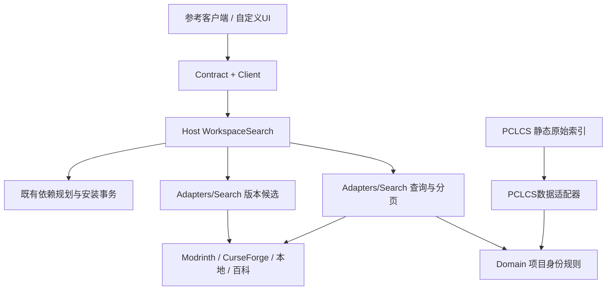

# 统一模组浏览与安装（2026-11-01）

基于 `60e6ea0` 的工作区实现；本轮没有更新固定0.41.0发布包，也没有把旧功能矩阵改成全部完成。

## 用户流程

主窗口模组入口和Windows风格下载页的模组入口接到统一浏览窗口。原本地管理、单站资源目录及其他资源功能保留。默认全部游戏版本、全部加载器、全部来源；可指定游戏版本、加载器或Modrinth/CurseForge/本地/百科。百科是内置索引，不宣称实时下载站。

结果按可靠项目映射合并。一张卡片可以保留多个下载项目；仅名称相同不合并，同一百科页含多个移植项目也不自动合并。列表来源标签代表本次取得的结果，关联但不可用的来源在版本查询中明确说明。

选择卡片不自动请求版本。点击“选择版本与下载来源”后可选择目标实例，再查询兼容候选；目标实例决定Minecraft版本与加载器，改变目标清空旧选项，要求重新查询。版本列表标明网站/发布版本/发布渠道，下方显示文件名、游戏版本和加载器。来源筛选只筛选Host已经验证的候选，不改变下载句柄。

原版实例没有模组加载器时给出提示，不暗中安装加载器。允许作者禁止自动下载的文件通过原网页手动下载，再交Host按来源记录的大小和SHA-1匹配。依赖解析与安装沿用既有事务，不能由UI指定任意下载URL。

## 结构

PCLCS仍负责原始数据格式与兼容实现，没有加入网络搜索控制器或UI。具体职责见[vendor集成说明](../vendor/PCLCS/README.integration.md)。Domain不依赖Ports/PCLCS，Desktop不依赖Core。旧类型命名空间保持兼容，统一搜索执行类移入Core/Adapters/Search。

## 关键约束与修复

1. 使用内置索引的一对一明确关联。重复slug或同百科多条关系拒绝自动合并；不使用标题、作者显示名或modId猜测跨站身份。当前映射仍是固定数据，不保证网站迁移后的永久正确，也没有在线更新/用户编辑功能。
2. 统一查询保留原词，并追加至多两个精确中文名对应词；允许移除内置中文名称尾部的英文括注再匹配。不会把模糊查询直接替换为热度最高项目。旧单站兼容入口仍保留原有行为。
3. 指定游戏版本和加载器时，在线模组查询额外核验同一文件同时满足条件。未指定的维度不限制；百科在统一过滤查询中不冒充已验证兼容结果，专用百科入口仍明确提示需联网检查。Quilt原有Fabric候选路径保留，最终依赖仍由既有求解器验证。
4. 读取双方来源版本，不再使用`if/else if`只读取第一站。缺少CF密钥/镜像、单站故障会显示，不能变成“完整搜索且无结果”。自动跨站替换文件没有实现，也不暗中发生。
5. 下载选择采用MR数组后接CF数组的唯一扁平索引。修复混合数组从0编号会撞句柄的问题；安装/手动匹配仍绑定目标实例。旧记录仅含单来源的索引语义保持不变。
6. 版本候选保留每站的真实项目/文件身份和哈希。Modrinth沿用原实现选择版本的主文件；没有声称支持任意附件选择。CF通过官方slug参数查询并要求返回slug精确相同，不以模糊搜索第一条作为关联结果。
7. 分页按各来源页推进，合并可能导致某页少于20项或为空但仍有下一页。会话快照30分钟、最多100页；Host重启需要重新搜索，已持久选择记录独立保留。回到已浏览页会包含后续页补充的来源。

参考官方接口：[Modrinth搜索](https://docs.modrinth.com/api/operations/searchprojects/)、[Modrinth版本](https://docs.modrinth.com/api/operations/getprojectversions/)、[CurseForge REST](https://docs.curseforge.com/rest-api/)。接口支持不等于本轮真人CF在线验证。

## 本轮证据

- Core控制台套件241/241，其中新增6组涵盖映射歧义、跨站合并、别名扩展、兼容条件、混合索引、单站故障和取消。
- 真实独立Host合成混合来源测试8项：CF索引选取正确、MR索引不能当CF匹配、越界/跨实例拒绝、Host重启后快照仍可选。
- Mac真实Avalonia/Host/Modrinth流程14项：全部筛选默认、公开项目搜索、缺失CF配置提示、按需版本读取、来源选择、真实Fabric API下载/依赖校验/安装、本地重读和重开版本列表、列表控件实际生成。测试实例只有合成profile/version元数据，不是完整Minecraft安装；没有启动游戏。
- 首轮别名测试发现英文括注使精确中文名匹配不到，已修正；首轮真实安装因为合成实例未声明Java21而被正确拒绝，修正测试元数据后成功，未放松依赖检查。
- 架构守卫通过；详细指标与报告哈希见同目录结果JSON。编译0错误，仍有既有Avalonia警告与NuGet漏洞数据不可达警告。

原始日志、截图、隔离实例在忽略目录 `artifacts/unified-browser/`。无CF真实密钥或付费镜像测试；同名与明确映射的双站合并使用元数据夹具，不能称为CF线上端到端。没有真人登录、皮肤修改、游戏世界或Windows/Linux图形验收；账户和游戏进程生产实现未改。

复验入口：构建`tests/Pcl.Tests`后运行控制台DLL；`tests/Pcl.Workspaces.Tests --unified-contract <全新目录> <报告>`；Mac Desktop `--unified-browser-smoke --data-root <隔离根> --remote-report <报告>`需`.unified-browser-test`标记、无账户以及ID为`unified-test`的Fabric1.21.1实例元数据（Java21、loader0.19.5）。不可将探针指向个人实例。UI探针为自动驱动真实控件流程，不代表人工逐页验收。

后续：在线映射更新/来源撤销、用户词库、任意附件选择、更多远端站点、全局相关度排序，以及CF真实服务验收仍独立待办。不以此轮实现减少全部35项缺口。
